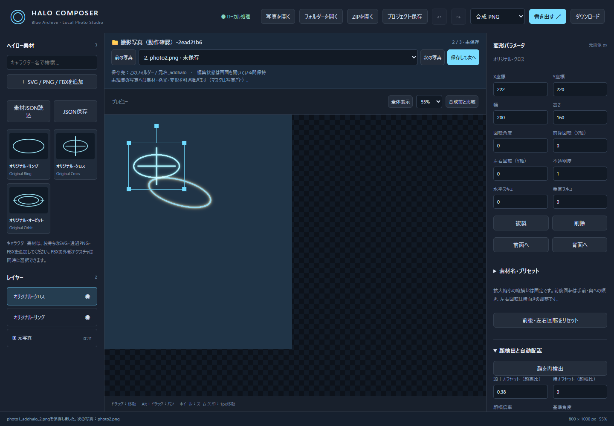

# Blue Archive Halo Composer

Windows 11 / Chrome・Edge向け、日本語のローカル写真合成アプリです。React 19.3.0 + TypeScript 5.9.3 + Vite 8.3.4、Fabric.js 7.4.0、Three.js 0.186.1、MediaPipe Tasks Vision 0.10.32を使用し、依存関係は`package-lock.json`で固定しています。



写真のフォルダーを開き、SVG・透過PNG・FBXのヘイローを調整して、元フォルダーへ`元名_addhalo`で保存できます。次の写真へ発光と変形の設定を引き継ぎ、各写真の編集内容も保持します。顔認識・合成・書き出しはローカル処理です。

## Windowsで起動

Node.js 24 LTSを用意し、このフォルダーをPowerShellで開きます。

```powershell
npm ci
npm run dev
```

表示された `http://127.0.0.1:5173/` をChromeまたはEdgeで開いてください。`start-dev.cmd`からも起動できます。初回の依存関係インストールにはネット接続が必要ですが、写真の編集・顔検出・出力に接続は不要です。

ビルド済み配布ZIPには`dist/`を同梱しています。`start-offline.cmd`をダブルクリックすると、Node.js標準機能のローカル静的サーバーで起動します。こちらはnpmインストール不要です。Node.jsを事前にインストールしておけば、ネットを切断した状態で起動できます。GitHubのソース版には`dist/`を含まないため、`npm ci`と`npm run build`で作成してください。ファイルを直接ダブルクリックする`file://`での起動はWorker/WASMのため非対応です。

ソースから本番版を作り直す場合：

```powershell
npm run build
npm run preview
```

## 編集の流れ

1. 「フォルダーを開く」で写真のあるフォルダーを選択するか、JPEG / PNG / WebP写真を開く／ドラッグ＆ドロップします。EXIF Orientationを反映して元ピクセル寸法を確定します。元ファイルを上書きする機能はありません。
2. 左の素材をクリックするとレイヤーを追加します。必要なときに最大辺1024pxの画像をWorkerで顔検出し、額と両目から頭上への仮位置・顔幅に応じた大きさ・ロール角を計算します。
3. 複数の顔がある場合、右の「対象の顔」を選び「初期配置を再実行」を押します。頭上／横オフセットは顔の高さ／幅に対する比率です。検出に失敗した場合は「頭の中心をクリックして配置」かドラッグを使います。クリック位置から上方向へ仮配置し、数値で調整できます。
4. ドラッグ、回転ハンドル、縦横比を固定した幅と高さ、水平／垂直スキュー、X/Y、角度、不透明度で精密調整します。矢印キーは元写真の1px、Shift＋矢印は10px。Alt＋ドラッグ／中ボタンでパン、ホイールでズーム、「全体表示」でパンを解除できます。表示倍率を変えても編集座標は変わりません。
5. 発光はCore / Inner / Outerの3層です。それぞれ明るさ、不透明度、ぼかしを調整でき、色、全体強度、半径倍率、通常／スクリーン／加算とプリセットを選べます。ぼかしは素材の可視幅1000pxを基準にした値です。
6. 「非表示ブラシ」でウィッグなどの後ろに隠す部分を塗り、「復元ブラシ」で戻します。マスクは選択レイヤーに追従し、本体と発光へ適用されます。描画中の軌跡はガイドで、マスクはボタンを離したときに反映します。赤表示は確認専用で書き出されません。
7. 上部で合成PNG／JPEG／ヘイローのみの透過PNGを選び、「書き出す」で元フォルダーへ「元ファイル名\_addhalo」として保存します。単独で開いた写真は初回保存時に元フォルダーを選択します。すべて元写真と同じピクセル寸法です。透過PNGには背景写真を含めません。写真外にはみ出した部分は出力範囲で切れます。
8. 「プロジェクト保存」でZIPに写真、素材、変形、表示順、発光、マスクを保存し、「ZIPを開く」で復元できます。Undo / Redoは最大40操作、ブラシは1ストロークで1操作です。Ctrl＋Z、Ctrl＋Shift＋Z、Ctrl＋Yに対応します。履歴とズーム／パンはZIPには保存しません。

手動編集済みのレイヤーは、顔の再検出だけでは位置を変更しません。「初期配置を再実行」は選択レイヤーを明示的に再配置します。ウィッグの体積や頭部の3D姿勢は推定しないため、仮配置は必ず目視調整してください。

## フォルダーで連続編集・保存

「フォルダーを開く」で元写真のフォルダーを選び、Chrome / Edgeのフォルダー書き込みを許可してください。[File System Access API](https://developer.chrome.com/docs/capabilities/web-apis/file-system-access)でローカルに保存します。フォルダー直下のJPEG / PNG / WebPをファイル名の数字順（例：photo2 → photo10）で読み込みます。サブフォルダーと、末尾が\_addhalo／\_addhalo_2等の出力画像は一覧から除外します。画像本体は選択したときだけ読み込みます。

中央の「前の写真」「次の写真」、写真一覧から移動できます。「保存して次へ」は現在の画像を保存した後に次へ移動し、最後の写真では「保存して完了」と表示します。保存を拒否・キャンセル・失敗した場合は移動しません。戻ると写真ごとのレイヤー・変形・回転・発光・マスク・選択を復元します。保存後に修正すると「変更あり」と表示します。Undo / Redoは現在の写真内で使い、写真を切り替えると履歴をリセットします。

初めて編集する写真へ移動すると、直前の写真のヘイロー素材・レイヤー順・表示状態・選択と、発光設定（各層、色、強度、半径、合成モード）、変形パラメーター（X/Y、幅／高さ、回転、前後／左右回転、スキュー、不透明度）を引き継ぎます。「次の写真」「保存して次へ」、一覧からの移動に共通です。座標とサイズは元画像pxの数値をそのまま保持し、自動配置は実行しません。写真の解像度や構図が異なる場合は手動調整、または顔を検出して「初期配置を再実行」を使ってください。

写真ごとの遮蔽に使うマスクは、新しい写真では空から始めます。すでに開いた写真へ戻る場合は、その写真の編集状態を優先して復元し、他の写真で変更した発光・変形を上書きしません。全レイヤーを削除した状態も保持します。別のフォルダーを開くと、レイヤーを追加するところから始めます。

合成画像・ヘイローのみの画像は同じフォルダーに新規保存します。PNG選択なら`IMG_001.jpg → IMG_001_addhalo.png`、JPEG選択なら`IMG_001.jpg → IMG_001_addhalo.jpg`です。拡張子は出力形式に従います。同名が存在すれば`IMG_001_addhalo_2.png`、`_3`…と連番にし、元写真・既存出力を上書きしません。

「写真を開く」やドロップで開いた場合は、初回の「書き出す」で元写真と同じフォルダーを指定します。同名の別画像への誤保存を防ぐため、元写真の内容が一致することを確認します。ZIPから復元した場合も元写真のあるフォルダーを指定できます。「ダウンロード」はブラウザー設定に従う別保存で、元フォルダーへの直接保存は行いません。プロジェクトZIP・素材JSONはダウンロードで保存します。

写真ごとの編集状態はこの画面を開いている間の保持です。ページを再読み込み・終了したり、別フォルダー／単独写真を開くとフォルダーの編集状態は引き継ぎません。続きの作業が必要な写真は個別にプロジェクトZIPを保存してください。ZIPは現在の1枚のプロジェクトで、フォルダー全体の編集状態やフォルダーアクセス権は含みません。同じ写真のZIPを現在のフォルダー編集へ読み込む場合は、その写真の編集状態を置き換えます。

## 素材とプリセット

キャラクター素材は同梱していません。使用権限のあるSVG・透過PNG・FBXを追加してください。独自の幾何学リング3点を操作確認用に同梱しています。原作キャラのヘイローを再現したものではありません。

素材レイヤーを選び「素材名・プリセット」から日本語名・英語名を設定できます。検索は両方に対応します。現在の自動配置設定を素材へ保存し、「JSON保存」で画像を含む素材ライブラリとして持ち出せます。「素材JSON読込」で追加できます。初期カタログは`src/catalog.json`です。閉じる前にJSONまたはプロジェクトZIPを保存してください。

可視アルファの外接範囲を基準にトリミングし、SVGの大きな余白は配置サイズへ含めません。SVGは高解像度出力時に再描画します。外部SVGは許可した図形・属性のみを保持し、スクリプト、イベント、外部画像、外部URL、埋め込みHTML、CSS／アニメーション、DOCTYPE／ENTITYを除去または拒否します。安全なインラインのfill・stroke等は保持します。`style`要素・クラス指定、`use`要素、SVG独自フィルター、テキストは対応範囲外で、事前にパス化とインライン属性への変換が必要です。

## FBXと前後回転

左の「SVG / PNG / FBXを追加」でFBXを選択できます。Three.jsの公式[FBXLoader](https://threejs.org/docs/pages/FBXLoader.html)を使用し、ASCII 7.0以降／Binary 6400以降を読み込みます。1モデル20MB、頂点数200万までです。FBXと外部テクスチャ（PNG / JPEG / WebP）を同時に選択してください。テクスチャは32枚・各10MBまでで、ファイル名で照合します。埋め込み画像にも対応します。外部URLへは接続せず、不足したテクスチャは警告を表示して単色で描画します。

「前後回転（X軸）」で手前・奥への傾き、「左右回転（Y軸）」で左右の向きを変更します。従来の「角度」は写真平面内の回転です。前後・左右回転はSVG・PNGにも適用でき、板状の素材として傾けます。幅と高さの入力は連動し、四隅のハンドルも縦横比を維持します。Shiftを押しても縦横比は解除しません。傾きによる見かけの形状変化とスキューは利用できます。

FBXは中心とサイズを正規化して正投影で合成し、薄い平面モデルは広い面が正面を向くように初期補正します。初期方向が意図と異なる場合はX/Y回転で修正してください。FBXの描画は最大辺4096pxで、その後元写真サイズへ合成します。WebGL 2とChrome / Edgeのグラフィックアクセラレーションが必要です。

FBXの元データと同時選択したテクスチャ、X/Y回転はプロジェクトZIP・素材JSONに保存します。以前のプロジェクトはX/Y回転0°として読み込めます。マスクは投影された素材上の座標で保持するため、前後・左右の角度を決めてから塗ると調整しやすくなります。FBXのアニメーションは再生せず、静止状態を扱います。

## ローカル処理とライセンス

写真・素材・検出座標はブラウザーのメモリー内で処理します。外部API、データベース、Pythonバックエンド、CDN、解析テレメトリーはありません。ローカルサーバーは127.0.0.1にだけ接続し、写真を受け取るアップロードAPIを設けていません。合成画像の保存は許可された元フォルダーへ直接行い、プロジェクトZIP・素材JSONと別保存はブラウザーのダウンロードです。

MediaPipeのモデル（float16/version 1）、WASM、ライセンス、公式モデルカードは`public/mediapipe/`と`dist/mediapipe/`にあります。取得元とSHA-256は`manifest.json`に記録しています。モデルの再取得・WASMコピーには`npm run assets`を使います。

素材の再配布権とコードのライセンスは別に確認しました。参照OSSと採用判断は[THIRD_PARTY_NOTICES.md](THIRD_PARTY_NOTICES.md)、ソフトウェアのライセンス本文は`public/licenses/`です。原作素材のMIT表示だけを根拠にゲーム側の権利まで許諾されたとは扱っていません。

本アプリのコードと独自の幾何学素材は[MITライセンス](LICENSE)で公開します。第三者のライブラリ・モデル・WASMには、それぞれのライセンスが適用されます。ユーザーが読み込む写真やキャラクター素材の権利を、このMITライセンスで許諾するものではありません。

## 検証

```powershell
npm run build
npm test
```

テストは起動済みの開発サーバーに対してChromeを使用します。Edgeで実行する例：

```powershell
$env:HALO_BROWSER = 'C:\Program Files (x86)\Microsoft\Edge\Application\msedge.exe'
npm test
```

実顔の3テストを実行するには、使用権限のある正面顔の写真を指定してください（この検証ではGoogle公式テスト画像を作業フォルダーへ取得して使用しました。アプリには同梱しません）。

```powershell
$env:HALO_TEST_PORTRAIT = 'C:\test-images\portrait.jpg'
npm test
```

画像を指定しない場合、該当画像が作業フォルダーにない環境では実顔テストのみスキップします。ビルド済み版の実顔・出力確認には`$env:HALO_PRODUCTION_URL = 'http://127.0.0.1:4173'`を指定します。詳しい実行結果は[TEST_RESULTS.md](TEST_RESULTS.md)に記載しています。

埋め込みテクスチャ付きバイナリFBXのテストには`$env:HALO_TEST_FBX = 'C:\test-models\embedded.fbx'`を指定します。この検証ではThree.js公式例の`monkey_embedded_texture.fbx`（Binary 7.4）を作業フォルダーで使用し、配布物には含めていません。未指定・ファイルなしの場合はその1件をスキップします。リングのASCII FBXはテスト内で独自生成します。

## 制約

- 4000×6000pxで検証済み。最大1億画素・一辺32760pxですが、利用可能なメモリーやChrome/EdgeのCanvas上限によってそれ以下でも失敗することがあります。PNGは元解像度、JPEGは品質0.95で出力します。SVGの再描画は最大辺8192px、PNGの細部は入力解像度に依存します。
- 表示用の背景は最大辺1600pxに縮小するため、拡大時に写真の細部はぼけます。書き出しには元解像度の正立PNGを使用します。EXIF・撮影情報は出力へ引き継ぎません。ブラウザーのsRGB合成で、印刷向けICC／HDRワークフローは対象外です。
- 素材20MB、ZIP200MB／展開400MB、素材JSON100MB、200素材、100レイヤー、マスク点合計30万点まで。ZIP内の設定・参照・数値は読み込み時に検証します。
- 厳密な4点透視変形、バッチ処理、生成AIは対象外です。FBXは静的な形状・基本色・カラーテクスチャを扱い、アニメーション再生や物理ベースの照明は対応していません。
